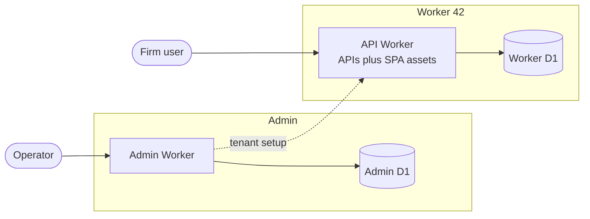
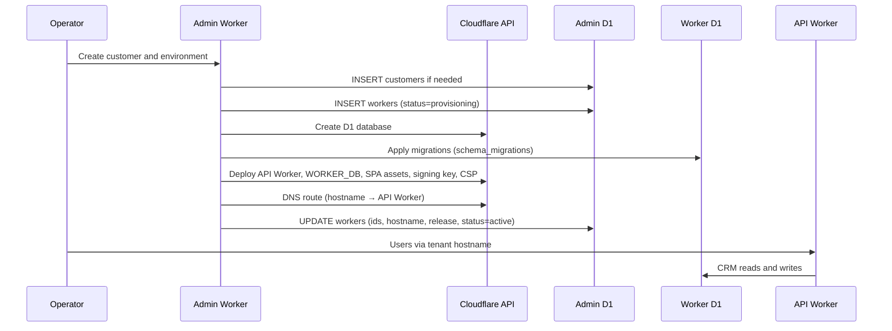

# ADR 0001: One D1 per worker environment

| | |
|---|---|
| **Status** | Accepted |
| **Date** | 2026-06-02 |
| **Revised** | 2026-10-21 — registry is the Admin Worker and Admin D1; each environment is one API Worker; tenant setup stays on the Admin Worker |
| **Deciders** | Platform / data architecture |
| **Related** | [ADR 0002](./0002-tenant-auth-security.md) (cookies, session, CSP, per-worker signing key), [ADR 0005](./0005-deployment-pipeline.md) (versioned artifacts, operator upgrades, `platform_release_id`) |

## Context

Typeed Forms is multi-tenant SaaS on Cloudflare. A **customer** is the billing firm. A customer owns one or more **workers**: each worker row is one deployed environment (production, UAT, training, and so on).

Each environment must support:

- Up to ~4,000 concurrent UK users
- ~5 GB of data over ~10 years (document-centric client management)
- **Strong isolation** and UK/EU data residency (GDPR)
- Compliance-sensitive financial / advice data
- **Extra environments** for UAT, training, or demos, separate from live client data
- **Network restrictions** — some firms require access only from known IPs (for example corporate VPN egress ranges)

We considered storing all customer data in a single shared D1 and filtering by tenant id. We rejected that. Isolation is the database and the Worker binding.

Cloudflare Workers have a compressed bundle size limit (order of single-digit MB per script). Migration SQL and provisioning do not belong in the tenant bundle. They run on the **Admin Worker**, which also owns the customer registry. Each environment still has a single public Worker: one API script plus the SPA assets. Auth for that Worker is [ADR 0002](./0002-tenant-auth-security.md).

## Decision

**Admin plane (one for the platform)**

- **Admin Worker** — customer registry and tenant setup (create the Worker D1, apply migrations, deploy the API Worker, attach the hostname, record status).
- **Admin D1** — `customers`, `workers`, `providers`. Relational columns, not the JSON `body` pattern. DDL: [`shared_tables.sql`](../../my-react-router-app/app/models/admin/shared_tables.sql).

**Each `workers` row (one environment)**

- **Worker D1** — `users`, `groups`, `clients`, cases, documents, contacts, and auth tables from ADR 0002. One database per environment. Never shared with another worker, including another environment of the same customer.
- **API Worker** — APIs and three Remix SPAs (CRM, Client, Contact) on the **same hostname**. SPA assets are attached to this Worker. Script name is stored on `workers.app_worker_name` and is derived from `id` and `slug`.

Tenant isolation is **which D1 the API Worker is bound to**. Rows in a Worker D1 are not filtered by a tenant id for isolation. `TrackingSchema.version` is optimistic concurrency on a row; it is not a schema version and it is not a tenant key.

```
Admin
└── Admin Worker → Admin D1
    ├── customers     billing firm; owns many workers
    ├── workers       one row per environment
    └── providers     marketplace list used by every tenant

Per environment (one workers row)
├── worker 42 API Worker → Worker D1 42    CRM + Client + Contact
├── worker 43 API Worker → Worker D1 43
└── …
```

A customer with production and training has two `workers` rows, two API Workers, and two Worker D1s.



### Admin Worker and tenant API Worker

| | **Admin Worker** | **API Worker** (one per `workers` row) |
|---|---|---|
| **Script name** | `typeed-admin` | `worker-{id}-{slug}` |
| **Bundle** | Customer admin, provisioning, migration SQL | APIs and three SPA asset sets |
| **Public route** | Internal admin hostname | Tenant hostname `/*` |
| **D1 binding** | `ADMIN_DB` | `WORKER_DB` (that environment only) |
| **R2** | No | Yes (documents) |
| **Invoked by** | Operators; upgrade jobs | End users (browser) |

**Request path:**

```text
Browser → WAF → hostname route → API Worker → Worker D1
```

**Tenant setup path** (customers and environments):

```text
Operator → Admin Worker → Admin D1
                       → Cloudflare API
                            create Worker D1
                            apply migrations
                            deploy API Worker + SPA assets + WORKER_DB
                            route hostname → API Worker
```

The Admin Worker applies migrations to the target Worker D1 through the Cloudflare D1 API before it deploys the API Worker. The API Worker does not ship migration SQL and does not run DDL.

### Admin D1 tables

| Table | Schema | Role |
|-------|--------|------|
| `customers` | [`customer.ts`](../../my-react-router-app/app/models/admin/customer.ts) | Billing entity (name, billing status, seats, production MAU, billing contact). Not a database and not a Worker. |
| `workers` | [`worker.ts`](../../my-react-router-app/app/models/admin/worker.ts) | One deployed environment. `customer_id` is required. `prod` marks the live environment. `status` is `provisioning`, `active`, `suspended`, `migration_failed`, or `provisioning_failed`. |
| `providers` | [`provider.ts`](../../my-react-router-app/app/models/admin/provider.ts) | Marketplace providers (business types). One list for every tenant. Not copied into Worker D1 as the registry. |

Customer MAU is metered from workers with `prod = true` only. Per-environment MAU, database size, and document size live on the `workers` row.

## Consequences — benefits

| Benefit | Why it matters |
|---------|----------------|
| **Hard isolation** | Customer rows are not in a shared tenant database. A bad query or bug stays inside one Worker D1. |
| **Environments stay separate** | Production and training for the same customer are different databases. Resetting training cannot touch live data. |
| **Compliance narrative** | “This environment’s data lives in its own database” is literally true. |
| **Independent scale shape** | A hot environment does not share a SQLite file with a cold one (within Cloudflare D1 limits). |
| **Per-environment lifecycle** | Export, freeze, or delete one environment by operating on one Worker D1, one API Worker, and its R2 prefix. |
| **Schema split** | Admin D1 stays relational for registry rows. Worker D1 uses JSON `body` plus generated columns (see [d1-sql-json-body.mdc](../../.cursor/rules/d1-sql-json-body.mdc)). |
| **Smaller tenant bundle** | Migration SQL and provisioning live on the Admin Worker, off the user request path. |

## Consequences — costs

| Cost | Mitigation |
|------|------------|
| **N Worker D1s and N API Workers** | The Admin Worker provisions them. Never hand-provision. The `workers` row stores `d1_database_id`, `app_worker_name`, and `hostname`. |
| **Schema drift** | One migration source in the repo. `schema_migrations` in **every** Worker D1. The Admin Worker applies pending versions before deploying that environment’s API Worker. |
| **Operational visibility** | Name D1 and Worker scripts `worker-{id}-{slug}`. Log `worker_id`. Compare `schema_migrations` across workers. |
| **Deploy fan-out** | Same API Worker artifact for every environment. Bindings, script name, secrets, and hostname differ. Order is migrate, then deploy. |
| **Release coupling** | `workers.platform_release_id` is the running app version. The API Worker knows the minimum schema version it requires. The Admin Worker owns `LATEST_SCHEMA_VERSION` and migrates first. |
| **Local dev** | `wrangler.jsonc` keeps one example `WORKER_DB`. Tests use a single Worker D1. Admin D1 is a separate database. |
| **Cost surface** | One script per environment, plus the Admin Worker. Monitor `db_size_mb` and `docs_size_mb`. Honour `expires_at` on temporary environments. |
| **Cross-environment reporting** | Platform analytics read Admin D1 or an export pipeline. Do not join Worker D1s on the request path. |

## Extra environments (UAT, training, demo)

These are further `workers` rows for the same `customer_id`. Same isolation as production: one API Worker and one Worker D1 each. There is no shared sandbox database.

| | Production | UAT / training / demo |
|--|------------|------------------------|
| `prod` | `true` | `false` |
| `label` | empty, or “Production” | e.g. `UAT`, `Adviser training` |
| Hostname | `example-financial.app.typeedforms.co.uk` | `example-financial-training.app.typeedforms.co.uk` |
| `expires_at` | usually empty | optional auto-archive time |
| Customer MAU | included | excluded |

```sql
-- Admin D1 — training environment for customer 7
INSERT INTO workers (
  customer_id, name, slug, label, prod, status, expires_at
) VALUES (
  7,
  'Example Financial (Training)',
  'example-financial-training',
  'Adviser training',
  0,
  'provisioning',
  '2027-06-01T00:00:00Z'
);
```

Rules:

- Training deletes and resets run against that Worker D1 only.
- Seed synthetic clients at create. Cloning production requires an explicit export and anonymisation job.
- Logins exist only in that environment’s Worker D1 ([ADR 0002](./0002-tenant-auth-security.md)).
- Billing uses the customer row. Non-production workers stay out of customer MAU.

## Network access (VPN / IP allowlist)

Some customers require that only traffic from their corporate network can reach an environment. Enforcement is at the **edge** (hostname plus Cloudflare WAF), independent of which D1 is bound.

Each hostname routes to that environment’s **API Worker**. WAF rules are scoped with `http.host`.

```text
User (on VPN) → corporate egress IP → Cloudflare WAF → API Worker → Worker D1
User (off VPN) → block (403) before the Worker runs
```

Example WAF custom rule (zone-level, host-scoped):

```txt
(
  http.host eq "example-financial.app.typeedforms.co.uk"
  and not ip.src in $example_financial_allowed_ips
)
→ Block
```

Keep `$example_financial_allowed_ips` as a Cloudflare IP list (firm VPN ranges plus break-glass operator IPs). Update it via API when the customer changes provider or adds a region.

`workers_dev` stays false on tenant scripts. WAF does not apply to `*.workers.dev`.

Allowlist the **egress IPs** the VPN presents to the internet. Customers must supply CIDRs. Split-tunnel users can bypass the VPN unless policy forces a full tunnel. Remote staff can be covered by extending the list, by [Cloudflare Access](https://developers.cloudflare.com/cloudflare-one/policies/access/) (identity and device posture), or by both: WAF for the office and Access for remote staff.

An optional Worker-level check is defence in depth only. The WAF should reject unwanted traffic before the Worker runs. Store any CIDR list in that API Worker’s env.

## Tenant setup (Admin Worker)

Triggered from the admin console when an operator adds a customer or an environment. Order: registry row, Worker D1, migrations, API Worker, hostname, mark active.



On failure set `workers.status` to `provisioning_failed` or `migration_failed` and stop. Do not route the hostname to a Worker whose migrations did not finish.

### 1. Register the customer and the worker (Admin D1)

```sql
INSERT INTO customers (name, billing_email, seats_count)
VALUES ('Example Financial Ltd', 'billing@example-financial.co.uk', 25);
-- application assigns customer id = 7

INSERT INTO workers (customer_id, name, slug, prod, status)
VALUES (7, 'Example Financial', 'example-financial', 1, 'provisioning');
-- application assigns worker id = 42
```

### 2. Create the Worker D1 (Cloudflare API)

Name: `worker-{id}-{slug}` (unique, grep-friendly in the dashboard).

```bash
ACCOUNT_ID="<cloudflare_account_id>"
API_TOKEN="<token_with_d1_edit>"

curl -sS -X POST \
  "https://api.cloudflare.com/client/v4/accounts/${ACCOUNT_ID}/d1/database" \
  -H "Authorization: Bearer ${API_TOKEN}" \
  -H "Content-Type: application/json" \
  --data '{"name":"worker-42-example-financial"}' \
  | jq '.result.uuid, .result.name'
# uuid is stored on workers.d1_database_id
```

The Admin Worker holds this API token as a secret. Tenant API Workers do not.

### 3. Apply migrations

The Admin Worker runs the Worker D1 migration set against that database id (D1 HTTP API or the equivalent of `wrangler d1 execute`). Details are in [Schema migrations](#schema-migrations) below. This step finishes before the API Worker is deployed.

### 4. Deploy the API Worker

One script per environment. SPA assets for CRM, Client, and Contact are attached here. Provision also installs that environment’s `SESSION_SIGNING_KEY` and the CSP / security headers from [ADR 0002](./0002-tenant-auth-security.md). The signing key is a Worker secret. Admin D1 may store a key id, never the key material. The Admin Worker uses `ADMIN_SESSION_SIGNING_KEY` and the same auth package against Admin D1 `operators` (ADR 0002 §11).

`wrangler.worker-42.jsonc` (generated):

```jsonc
{
  "name": "worker-42-example-financial",
  "main": "./workers/app.ts",
  "compatibility_date": "2025-04-04",
  "workers_dev": false,
  "d1_databases": [
    {
      "binding": "WORKER_DB",
      "database_name": "worker-42-example-financial",
      "database_id": "a1b2c3d4-e5f6-7890-abcd-ef1234567890"
    }
  ],
  "vars": {
    "WORKER_ID": "42",
    "WORKER_SLUG": "example-financial"
  }
}
```

```bash
pnpm wrangler deploy --config wrangler.worker-42.jsonc
```

The Workers Scripts API is the same idea when the Admin Worker uploads the script itself: one script, `WORKER_DB` bound to this D1, assets attached, no second script.

### 5. DNS / hostname → API Worker

```bash
ZONE_ID="<zone_id>"

curl -sS -X POST \
  "https://api.cloudflare.com/client/v4/zones/${ZONE_ID}/workers/routes" \
  -H "Authorization: Bearer ${API_TOKEN}" \
  -H "Content-Type: application/json" \
  --data '{
    "pattern": "example-financial.app.typeedforms.co.uk/*",
    "script": "worker-42-example-financial"
  }'
```

Custom domains attach to this API Worker.

### 6. Persist routing metadata (Admin D1)

```sql
UPDATE workers
SET
  d1_database_id = 'a1b2c3d4-e5f6-7890-abcd-ef1234567890',
  app_worker_name = 'worker-42-example-financial',
  hostname = 'example-financial.app.typeedforms.co.uk',
  platform_release_id = '2026.10.1',
  status = 'active',
  updated_at = datetime('now')
WHERE id = 42;
```

Users hit the API Worker on `hostname`. That Worker only has `env.WORKER_DB` for its own D1. Setup and later migrations are Admin Worker calls to the Cloudflare API, using `d1_database_id`.

## Schema migrations

### Two different versions

| Name | Scope | Purpose |
|------|--------|---------|
| `schema_migrations` | Database (DDL) | Which SQL files have been applied to **this** D1 |
| `body.version` (`TrackingSchema`) | Row (JSON) | Optimistic concurrency on entity updates |

Do not conflate them. `workers.platform_release_id` is a third thing: the app bundle currently deployed.

### Migration table

Admin D1 already creates this in [`shared_tables.sql`](../../my-react-router-app/app/models/admin/shared_tables.sql). Every Worker D1 gets the same table from migration `0000_init.sql`:

```sql
CREATE TABLE IF NOT EXISTS schema_migrations (
  version INTEGER PRIMARY KEY,
  name TEXT NOT NULL UNIQUE,
  applied_at TEXT NOT NULL DEFAULT (datetime('now'))
);
```

Example Worker D1 file: `migrations/worker/0001_clients.sql`

```sql
-- depends: 0000_init
CREATE TABLE IF NOT EXISTS clients (
  id INTEGER PRIMARY KEY AUTOINCREMENT,
  body TEXT NOT NULL,
  client_type TEXT GENERATED ALWAYS AS (json_extract(body, '$.client_type')) STORED,
  is_deleted INTEGER GENERATED ALWAYS AS (json_extract(body, '$.is_deleted')) STORED
);
CREATE INDEX IF NOT EXISTS idx_clients_deleted ON clients(is_deleted);

INSERT INTO schema_migrations (version, name) VALUES (1, '0001_clients');
```

### When migrations run

1. **Environment create** — after the D1 exists, the **Admin Worker** applies Worker D1 migrations from version `0` to `latest`.
2. **Platform upgrade** — for each `workers` row, the Admin Worker compares `MAX(schema_migrations.version)` with `LATEST_SCHEMA_VERSION` and applies pending files in order, then deploys the API Worker and sets `platform_release_id`.
3. **API Worker** — does not run migrations. A health check fails when `schema_migrations` is below the version that release requires.
4. **Admin D1** — its own `schema_migrations` covers `customers`, `workers`, and `providers` only. Never run Worker D1 DDL against Admin D1.

Pseudo-code, **Admin Worker** only. `db` is the target Worker D1 (D1 HTTP API), not `ADMIN_DB`.

```ts
const LATEST = 3; // highest migrations/worker/00NN_*.sql

async function ensureWorkerSchema(db: D1Database) {
  await db.exec(`CREATE TABLE IF NOT EXISTS schema_migrations (
    version INTEGER PRIMARY KEY,
    name TEXT NOT NULL UNIQUE,
    applied_at TEXT NOT NULL DEFAULT (datetime('now'))
  )`);

  const row = await db
    .prepare("SELECT COALESCE(MAX(version), 0) AS v FROM schema_migrations")
    .first<{ v: number }>();
  const current = row?.v ?? 0;

  for (let v = current + 1; v <= LATEST; v++) {
    const sql = WORKER_MIGRATIONS[v]; // bundled on the Admin Worker
    await db.batch([
      db.prepare(sql),
      db.prepare(
        "INSERT INTO schema_migrations (version, name) VALUES (?, ?)"
      ).bind(v, `000${v}_...`),
    ]);
  }
}
```

**Rules**

- Migrations are forward-only and idempotent where possible (`IF NOT EXISTS`).
- One migration file = one monotonic `version` integer.
- Never skip versions on a given D1.
- A failed migration leaves the worker in `provisioning_failed` or `migration_failed` until it is repaired.

### Wrangler local / CI

```bash
pnpm wrangler d1 execute worker-42-example-financial \
  --remote \
  --file=./migrations/worker/0001_clients.sql
```

Production applies migrations from the Admin Worker so the SQL stays out of the API Worker bundle. CI `wrangler d1 execute` is a fallback.

## What lives where

| Data | Database | Worker |
|------|----------|--------|
| Customers, workers, providers | Admin D1 | Admin Worker |
| Users, groups, clients, cases, documents, contacts, logins | Worker D1 | API Worker (user traffic) |
| DDL migrations | The D1 they alter | Applied by the Admin Worker |
| File bytes | R2 (per-environment bucket or prefix) | API Worker |

## Alternatives considered

| Alternative | Why not |
|-------------|---------|
| Single shared D1 for all customer data | Weaker isolation. Every query must enforce a tenant predicate. Higher compliance and bug blast radius. |
| A config Worker per environment, beside the API Worker | Tenant setup is an Admin Worker job. A second script per environment doubled the fleet and the deploy order. Migration SQL stays off the tenant bundle because the Admin Worker runs it. |
| One Worker with many D1 bindings | Binding surface and routing grow with every environment. Per-environment Workers match the isolation story. IP allowlisting still works as a per-host WAF rule. |
| One shared training D1 for all firms | Breaks isolation. Training is another `workers` row with `prod = false`. |
| Durable Objects per tenant | Not required for this workload. D1 plus one API Worker per environment is enough for document-centric CRUD. |

## Follow-up work

- [ ] Admin Worker provisioning job (D1 → migrate → deploy API Worker → hostname → `workers.status`)
- [ ] `migrations/worker/` applied only from the Admin Worker; API Worker bundle has no migration SQL
- [ ] API Worker health check against the schema version required by `platform_release_id` (see also [ADR 0005](./0005-deployment-pipeline.md))
- [ ] Align [db-diagrams.md](../skills/db-setup/db-diagrams.md), [db-tables.md](../skills/db-setup/db-tables.md), and the platform spec with Admin D1 / Worker D1
- [ ] Customer VPN CIDR onboarding and WAF IP list runbook
- [ ] Optional: Cloudflare Access policy template per tenant hostname

## References

- [ADR 0002 — tenant auth](./0002-tenant-auth-security.md)
- [`customer.ts`](../../my-react-router-app/app/models/admin/customer.ts), [`worker.ts`](../../my-react-router-app/app/models/admin/worker.ts), [`provider.ts`](../../my-react-router-app/app/models/admin/provider.ts), [`shared_tables.sql`](../../my-react-router-app/app/models/admin/shared_tables.sql)
- [README.md](../../README.md)
- [db-tables.md](../skills/db-setup/db-tables.md)
- [db-diagrams.md](../skills/db-setup/db-diagrams.md)
- [Cloudflare D1 — Create database](https://developers.cloudflare.com/api/resources/d1/subresources/database/methods/create/)
- [Cloudflare Workers — Limits (bundle size)](https://developers.cloudflare.com/workers/platform/limits/)
- [Cloudflare Workers — Routes](https://developers.cloudflare.com/workers/configuration/routing/routes/)
- [WAF — Allow traffic from IP allowlist only](https://developers.cloudflare.com/waf/custom-rules/use-cases/allow-traffic-from-ips-in-allowlist/)
- [Cloudflare Access](https://developers.cloudflare.com/cloudflare-one/policies/access/)
