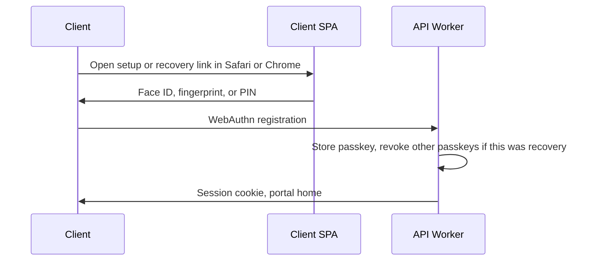

# ADR 0002: Auth for tenant apps and the Admin Worker

| | |
|---|---|
| **Status** | Proposed |
| **Date** | 2026-10-20 |
| **Revised** | 2026-10-21 — client sign-in is passkey or password, chosen per worker at setup; passkey recovery is a short-lived link that registers a new passkey. Admin Worker uses the same auth package with its own directory and signing key. Security notices (new device, credential changes, break-glass) go to that login’s own email; “This wasn’t me” signs the session out and does not sign anyone in |
| **Deciders** | Platform / security |
| **Related** | [ADR 0001](./0001-one-d1-database-per-account.md) (Admin Worker vs one API Worker per env), [platform app](../specs/platform-app.md) (operator roles and console routes) |

## Context

Each tenant environment is one Cloudflare Worker (APIs) + three Remix SPAs on the **same hostname**, all using the **same auth logic**:

| SPA | Principal | Domain record |
|-----|-----------|----------------|
| **CRM** | Adviser / staff | `users` |
| **Client** | Client | `clients` |
| **Contact** | Introducer | contact individual |

They call `/api/*` on the same origin.

The **Admin Worker** (`typeed-admin`) is a different script on an internal hostname, with Admin D1 and the Cloudflare API token ([ADR 0001](./0001-one-d1-database-per-account.md)). Operators are our staff. They are not firm users and do not belong in a tenant `logins` table. The sign-in ceremony is the same; the directory and the key are not (§11).

Goals:

- Cookie-based auth for all three SPAs (no tokens in `localStorage`).
- **Per-worker signing keys** — compromise of one env’s secret must not forge cookies for another.
- **Single active login** — a new successful login bumps `session_version` and invalidates any previous cookie for that login.
- **Idle auto-logout ~30 minutes** — sensitive data; warning in the UI; activity in any tab keeps the session alive.
- **Performance** — after a full ACL check (e.g. “can this user read client 23?”), issue a short-lived **capability cookie** so follow-up requests for that resource can skip a heavy ACL recompute.
- **New device** — email one-time code before establishing trust; remember the device afterwards.
- **Security notices** — after a new device, a replaced session, or a credential change, email that login. The message says what happened. **This wasn’t me** signs that session out. It does not sign anyone in (§12).
- **One auth package** for the tenant SPAs and the Admin Worker. Separate signing keys and separate directories.
- Stay compatible with Workers + D1.

## Decision

### 1. Cookie model (all SPAs)

| Cookie       | Purpose                       | Lifetime                                     | HttpOnly             | Notes                                                                                 |
| ------------ | ----------------------------- | -------------------------------------------- | -------------------- | ------------------------------------------------------------------------------------- |
| `tf_session` | Primary session               | Sliding **30 min idle** (see §7)             | Yes                  | Sealed. Bound to `login_id`, `principal_type`, `session_version`, `device_id`. |
| `tf_csrf`    | Double-submit CSRF            | Matches session                              | **No** (JS-readable) | Required for state-changing API calls.                                                |
| `tf_cap_*`   | Capability / “access” cookies | **≤ 30 minutes**                             | Yes                  | Scoped: resource type + id + actions. See §5.                                         |
| `tf_device`  | Trusted-device marker         | Long-lived (e.g. 90d)                        | Yes                  | Device public id + rotation counter; **not** sufficient alone to authenticate.        |

All cookies: `Secure`, `SameSite=Lax` (or `Strict` if UX allows), `Path=/`, host-only (no parent-domain sharing across tenants).

Each SPA has its **own login screen**. The client screen only creates a session when `principal_type = client`; CRM only `user`; contact only `introducer`. The API repeats that check on every route.

If the SPAs are path-prefixed, set the session cookie `Path` to that SPA so a client cookie is not sent to CRM. Still enforce `principal_type` on the server. Do **not** put session secrets in SPA JS.

### 2. Per-worker signing key

Each deployed environment has its own secret:

```text
SESSION_SIGNING_KEY   # Worker secret / encrypted env — unique per workers.id
```

- Generated at provision time; stored only as a Worker secret (never in Shared D1 plaintext).
- Platform registry may store a **key id** / rotation metadata, not the key material.
- Rotate by issuing a new key id; accept previous key for a short overlap window, then drop.
- The Admin Worker uses a **different** secret (`ADMIN_SESSION_SIGNING_KEY`) — never reuse a tenant key (§11).
- Provisioning also installs this env’s **CSP and security headers** (see §9). They are part of the worker deploy, not a later manual step.

Blast radius of a leaked key = **one environment**, not the whole platform.

### 3. Shared `logins` table (not embedded credentials)

All three SPAs use one auth implementation. Credentials live in a `logins` table in Worker D1, linked to exactly one principal:

| Column | Notes |
|--------|--------|
| `id` | Login id (cookie subject) |
| `principal_type` | `user` \| `client` \| `introducer` |
| `principal_id` | Id in `users`, `clients`, or contact individuals |
| `email` | Unique **with** `principal_type` (same address may be a client and an introducer) |
| `password_hash` | bcrypt / Argon2id. Null for every client on a passkey worker. Required for clients on a password worker (§10) |
| `session_version` | Integer; see §4 |
| `enabled` | Disable without deleting the domain row |
| lockout / `failed_attempts` | Shared by all SPAs |

**Unique indexes**

```sql
CREATE UNIQUE INDEX idx_logins_principal ON logins(principal_type, principal_id);
CREATE UNIQUE INDEX idx_logins_email ON logins(principal_type, email);
```

One login per domain row. The same email may exist once per principal type, not twice for two clients.

Changing `email` requires the current factor, bumps `session_version`, and sends the notice to the previous address and the new one (§12).

**Login screens (same auth code, different gate)**

| SPA | Accepts |
|-----|---------|
| CRM | `principal_type = user` |
| Client | `principal_type = client` |
| Contact (introducer) | `principal_type = introducer` |

A correct password for a `user` row submitted on the client screen is a failed login. Do not redirect them to the other app.

**Why a link table, not columns on user / client / contact**

- One code path for password, OTP, `session_version`, and lockout.
- A client or introducer row often exists **before** they have a portal login.
- Fact-find and contact JSON stay free of password hashes.
- Uniqueness is declared once, as the two indexes above.

Domain tables stay the profile (`users`, `clients`, contacts). Today’s nested `LoginDetailSchema` on the CRM user should move here; the user row keeps adviser settings only.

`trusted_devices.login_id` → `logins.id` (see §6).

### 4. Session validity — `session_version` is enough

**Request auth does not read a sessions table.**

A request is valid when all of these hold:

1. `tf_session` signature verifies with this worker’s key.
2. Cookie `exp` is in the future (idle window; §7).
3. `cookie.session_version === logins.session_version` for `cookie.login_id`.
4. `logins.enabled` is true.

**Login (any SPA):** verify the factor for that principal (§10) → `session_version += 1` → set cookie `{ login_id, principal_type, principal_id, session_version, device_id, am, exp }`. `am` is the auth method (`passkey`, `password`, `password+totp`, `break-glass`). It is audit only. It does not grant extra permission.

Any earlier cookie fails the version check. That is the single-active-session rule. Logout, password change, and admin force-logout also bump `session_version` and clear cookies.

A bump caused by a **new login** sends the notice in §12 (one email, not one for the new device and another for the signed-out session). Logout, idle expiry, and an admin force-logout do not send “you signed in elsewhere”.

`auth_events` **(append-only audit, not on the accept path):** login, logout, otp, device trusted, session replaced, `notice_sent`, `notice_failed`, `notice_denied`. Useful for support and FCA trace. Do not SELECT it to decide whether the cookie is valid.

Cache `session_version` briefly (Worker memory / Cache API) keyed by `login_id`; drop the cache entry whenever the version is bumped.

### 5. Capability cookies (skip heavy ACL on repeat access)

**Idea:** After a successful full ACL check for `client_id=23` with `read` (and/or `write`), set a short-lived capability cookie so the next request can skip recomputing group/linkage rules.

**Decision: allow as an optimisation, with hard safety rules — never as the only auth.**

Every API request still:

1. Validates `tf_session` (signature, expiry, `session_version` on `logins`).
2. Then **either** validates a matching capability cookie **or** runs full ACL.

**Capability cookie payload (signed, HttpOnly), example:**

```ts
{
  sv: session_version,      // must match logins.session_version
  login_id: login_id,
  typ: "client",
  id: "23",
  act: ["read"],            // or ["read","write"] — least privilege
  ver: acl_generation,      // optional: bump when roles/group access change
  exp: now + 30min
}
```

**Safety rules:**

| Rule | Why |
|------|-----|
| Bind to `login_id` + `session_version` | Stolen cap cookie useless after re-login / logout. |
| Max TTL **30 minutes** (or less) | Limits stale grant window. |
| Scope to **one resource** (+ actions) | No “god mode” capability cookie. |
| Cap cookie **never** replaces session auth | Only skips ACL **recompute**. |
| On permission change, bump `acl_generation` (user or group) and ignore old caps | Prevents retained write after access revoked. |
| Sensitive / irreversible actions (delete, export, send to lender) **always** full ACL | Defence in depth. |
| `SameSite` + CSRF on mutations | Cap cookie alone must not enable CSRF write. |

**Naming:** e.g. `tf_cap_client_23` or a single `tf_cap` bag with a small sealed map (watch cookie size limits ~4KB). Prefer few active caps; LRU discard server-side if needed.

**Missed risk if done naively:** “skip auth check” must **not** mean skip session validation — only skip **authorisation graph** walk.

### 6. New device → email code → remember device

**Decision:**

1. On login, compute a **device fingerprint id** (stable random id in `tf_device` cookie + server record). First visit: no trusted device → after password OK, require **email OTP** (6-digit, 10 min, single-use, rate-limited).
2. On OTP success: insert `trusted_devices` (`device_id`, `login_id`, `label`, `created_at`, `last_seen_at`, `revoked_at`).
3. Later logins from that device: password without OTP, unless the device row is revoked.
4. Revoke a device → next login from it needs OTP again. Existing cookie stays valid until idle expiry or `session_version` bump (logout / new login / password change).
5. A new successful login still bumps `session_version`, so the previous browser’s cookie dies even on a trusted device.

**Email OTP hardening:** rate limit per user + IP; invalidate on password change; do not reveal whether email exists beyond generic messaging where possible. The code email names the browser, the OS, and the time, and says to ignore it if they did not just try to sign in. Typing the code is the only way through. The message has no link that completes sign-in.

**Remember device ≠ remember password.** Device cookie is not a session.

A **passkey** login does not send this email code. The passkey is already a phishing-resistant proof of that person. The code stays for staff password logins on a new device, and for the client recovery link in §10. A passkey sign-in on a device we have not stored still sends the new-device notice in §12, and then stores the device so the next visit stays quiet. Storing it does not skip a factor.

### 7. Auto-logout (30 minutes, multi-tab)

Data is highly sensitive. **Idle timeout is 30 minutes** of no user activity.

| Layer | Behaviour |
|-------|-----------|
| **UI (all 3 SPAs)** | Shared idle clock. At **25 minutes** show a logout warning (“Stay signed in”). At **30 minutes** call logout and return to the login screen. |
| **API** | `tf_session.exp` is at most 30 minutes ahead. Expired cookie → `401`. The UI timer is not the only control. |
| **What counts as activity** | User input (click, key, touch) and user-driven API calls. Background polling must **not** refresh `exp` or the idle clock. |

**Multiple tabs**

- Store `lastActivityAt` in `localStorage` (same origin). Every tab listens for `storage` events (or `BroadcastChannel`).
- Activity in **any** tab resets the 30-minute clock in **all** tabs and may refresh the session cookie (`exp = now + 30m`) once, not on a tight poll.
- The warning shows only when the shared clock hits 25 minutes. “Stay signed in” writes a new `lastActivityAt` and refreshes the cookie.
- Logout in one tab broadcasts logout; other tabs clear state and redirect. Server bumps `session_version` so a leftover tab cannot keep calling APIs.

### 8. Crypto and transport baseline

- Argon2id or bcrypt (cost ≥ 12) for passwords; never store reversible passwords.
- Prefer **sealed** cookies (encrypt + MAC, e.g. iron-session style) over signed-only JWT in cookies — hides `user_id` / caps from casual inspection.
- TLS only; HSTS on tenant hostnames.
- Lockout / progressive delay after failed passwords.
- Audit: `auth_events` (login, logout, otp_sent, otp_ok, otp_fail, device_trust, session_replaced, notice_sent, notice_failed, notice_denied).

### 9. Strict CSP (set when each worker is provisioned)

Each SPA is served by that environment’s Worker. **Strict CSP is a response header on those asset responses**, written into the worker config at **provision** (and kept on every upgrade). A missing header on one env is a gap; do not rely on a `<meta>` tag alone.

Minimum for all three SPAs:

- `Content-Security-Policy` with `default-src 'self'`, `object-src 'none'`, `base-uri 'self'`, `frame-ancestors 'none'`, `form-action 'self'`
- No `unsafe-inline` / `unsafe-eval` in `script-src` (nonces or hashes if a bootstrap script needs them)
- `X-Content-Type-Options: nosniff`
- `Referrer-Policy: strict-origin-when-cross-origin`
- HSTS on the tenant hostname

Third-party script, font, or connect hosts are an explicit allowlist change, not a relaxed default. The provision template is the place this is applied so every new worker/env gets it.

### 10. Client sign-in — one method per worker

Session cookies stay as they are. This section is how a **client** proves who they are before `session_version` is bumped. Advisers, introducers, and operators are unchanged: staff use a password plus MFA, and a passkey can satisfy that MFA; operators use a passkey with password+TOTP as break-glass (§11).

**Honest option: the worker is either passkey or password. The login screen never offers both.**

A password sitting next to a passkey is the thing people will use, and the thing a phishing page will ask for. The passkey then changes nothing about the account’s strength. Firms that want passwords get a password worker. Firms that want passkeys get a passkey worker, and a lost phone is fixed by the client, with a short email link, not by an adviser opening the portal for them.

| | **Passkey worker (default)** | **Password worker** |
|--|------------------------------|---------------------|
| Set at | Environment setup. `workers.client_auth = passkey` | Same column, `password` |
| Who it is for | A firm whose clients can use a phone or computer unlock | A firm, or a training environment, that has decided its clients will not use passkeys |
| Client login | Passkey only. No password field | Email + password. New device still needs the email code in §6 |
| `password_hash` | Null | Required |
| Lost access | **Recover account** emails a short-lived link. The link only registers a new passkey | Password-reset link sets a new password |
| Adviser’s job | None, unless the email on the client record is wrong | None, beyond the usual “we don’t know your password” |

Store the choice on the Admin D1 `workers` row and copy it onto the API Worker as `CLIENT_AUTH` at provision. The login screen reads the env value. It does not ask Admin D1 on each visit. Changing it later is an operator action and a redeploy. It does not silently invent passwords for people who have only a passkey, and it does not stop accepting passwords until those clients have a passkey.

There is no third mode where an adviser grants a short session. That puts every locked-out client through a person, and it creates a portal login that skipped the factor the worker was set up to require.

**TOTP vs passkey, for staff.** A TOTP app stops a stolen reused password. It does not stop a site that relays the code in real time. A passkey or hardware key does. Advisers and introducers ship with TOTP so MFA is mandatory before everyone has a passkey. SMS is not a factor (SIM swap). Clients on a password worker do not get TOTP; the new-device email code in §6 is their second check. Clients on a passkey worker do not get that email code on a normal sign-in.

#### 10.1 Passkey worker

WebAuthn credentials live in `login_credentials` (`login_id`, credential id, public key, sign counter, backup state). One login can hold more than one passkey. The WebAuthn user handle is `login_id`, not the email, so the same address can be a client and an introducer with two passkeys.

**Relying party id is that environment’s hostname** (`example-financial.app.typeedforms.co.uk`), never a parent like `typeedforms.co.uk`. A passkey must not work on another firm’s host, or on that firm’s training host. Do not publish a related-origins file to join them.

| Setting | Value | Why |
|---------|--------|-----|
| Resident / discoverable key | Required | Returning visit can be one tap. |
| User verification | Required | Face ID, fingerprint, or device PIN. |
| Attestation | None | We do not need the device vendor. Collecting it is a privacy cost for consumers. |
| Sign counter | Store it; do **not** lock the account when it stays 0 | Synced passkeys often never increment. Locking on that is a common outage. |
| Backup flags | Store them | So the device list can say “synced” or “this device only”. |

**First visit.** The adviser turns on portal access. The API creates the `logins` row with `password_hash` null. The adviser does not choose a password and never sees one. The email is a setup link: **24 hours**, single use, bound to that `login_id`. A new link cancels the previous one. Cap sends at 3 per hour per login.



1. If the link is opened in an in-app browser, stop and ask for Safari or Chrome. Do not start WebAuthn there.
2. The page says they will use Face ID, fingerprint, or their screen lock, and that there is no password. The button is **Continue**. The OS shows its own sheet.
3. On success, store the credential, set `am = passkey`, bump `session_version`, and leave them in the portal. Setup and first sign-in are the same visit.
4. A couple who both use the portal are two client logins and two passkeys.

**Coming back.** The screen is **Sign in**. Discoverable credentials let the browser offer the passkey without typing an email. Failure copy does not reveal whether an address exists. No email OTP on top (§6). The new-device notice in §12 still goes out the first time that device is seen. **Add this phone or computer**, while signed in, registers a second passkey and does not revoke the first. That sends the “new passkey” notice (§12).

iCloud Keychain and Google Password Manager copy a passkey onto a new device on the same cloud account. That cloud account is part of the trust chain. The device list says “synced” or “this device only” from the backup flags. We cannot stop the OS from syncing. Prefer the client’s own phone.

**Recover account.** This is the only lost-device path. The client starts it from the login screen. An adviser may resend that same email from the CRM if the client cannot find it. Resending does not sign anyone in, and the adviser does not get a session.

| Rule | Value |
|------|--------|
| Lifetime | **30 minutes** |
| Use | Once. A newer link cancels the older one |
| What the page can do | Register a new passkey. Nothing else |
| After a passkey is stored | Revoke every other passkey on that login, then start the session |
| Rate limit | 3 per hour and 10 per day per login, plus a per-IP limit |
| Copy on failure | Generic. Do not reveal whether the email has a login |

The first-invite link lasts 24 hours because the client may not open it today. Recovery is 30 minutes because it retires the old passkeys, including one on a stolen phone. Revoke only after the new passkey is stored, so a failed recovery does not lock the phone they still have.

The setup link and the recovery link both say: if you did not ask for this, ignore the email. Nothing changes until the new passkey is stored. After recovery stores one, send the “passkeys replaced” notice (§12).

Someone who has lost the inbox as well is stuck until the firm corrects the email on the client record and a new link goes to the new address. That is a data fix. It is not a temporary portal login.

Someone who cannot use a passkey at all (no phone, only a public PC, or they will not use device unlock) should be on a **password worker**. Do not add a passkey exception for them inside this mode. A passkey created on a public computer is a mistake; the setup page says to use their own phone and recover later on that phone.

**Words the client actually sees**

| Moment | Words |
|--------|--------|
| Setup | “Set up sign-in on this phone or computer. You’ll use Face ID, fingerprint, or your screen lock. There is no password.” |
| Footnote | “This is a passkey — the same sign-in Apple, Google, and many banks use. We never see your face, fingerprint, or PIN.” |
| Next visit | “Sign in” |
| Lost phone | “Recover account” |
| Wrong browser | “Open this link in Safari or Chrome to continue.” |

Adviser script, shown in the CRM for passkey workers:

> There isn’t a password. Open the email and tap the button, then use Face ID, fingerprint, or the phone PIN. We never see that PIN. A new phone on the same Apple or Google account usually brings sign-in with it. If not, tap Recover account on the sign-in page and the email lets them set it up again. We can’t read a password out because there isn’t one.

#### 10.2 Password worker

Choose this at setup when the firm already knows passkeys will not be usable for their clients. The client screen is email and password. `password_hash` is required. New browsers still go through the trusted-device email code in §6.

**Reset password** is its own short-lived link: **30 minutes**, single use, generic response, same send limits as passkey recovery. The page sets a new password. It does not register a passkey, and it does not sign them in until the new password is saved and, on a new device, the email code succeeds. The adviser never sees or chooses the password. The reset email says to ignore it if they did not ask; the password is unchanged until the page is finished. After a change or a completed reset, send the “password changed” notice (§12).

This worker does not also accept a client passkey. Offering one “as a nicer extra” while the password still works would make the password the real key again.

#### 10.3 What either method does not replace

Idle logout, CSP, `principal_type` checks, `session_version`, capability cookies, and the notices in §12 still apply after login. The worker setting is how they get the cookie. It is not a second kind of session.

### 11. Admin Worker — same package, separate directory

The Admin Worker can use this auth. It must not use a tenant’s `logins` table, cookie, or signing key.

**Package the ceremony. Configure the directory.**

Put one implementation in `packages/auth`, imported by the tenant API Worker and by the Admin Worker. Two deploys of one library. Do not copy the files into each app. Do not service-bind a tenant Worker to the Admin Worker to “log in through admin” — that couples their uptime and puts admin reachability on the client path. ADR 0001 already keeps migration SQL off the tenant bundle; this package is small (cookie sealing, WebAuthn, TOTP, idle clock) and is allowed in both bundles.

| In the package | Passed in by each Worker |
|----------------|--------------------------|
| Seal and open cookies | Signing key |
| `session_version` check | Directory adapter (where the row lives) |
| CSRF double-submit | Cookie name prefix |
| Password hash and TOTP | Which factors exist |
| WebAuthn register and assert | Relying party id and origin |
| Email OTP generate and check | Idle minutes, `SameSite` |
| Which security notice to send, and the “This wasn’t me” token (§12) | Mailer. The Worker sends the email. The package does not |
| Lockout policy | |
| Idle clock (warning, logout, shared across tabs) | |
| `auth_events` event names | |

```ts
createAuth({
  cookiePrefix,   // "tf" on a tenant, "tf_admin" on the Admin Worker
  signingKey,
  directory,      // Worker D1 logins, or Admin D1 operators
  factors,        // §10 table
  idleMinutes,    // 30 tenant, 15 admin
  sameSite,       // "Lax" tenant, "Strict" admin
  rpId,
  origins,
})
```

The directory adapter is the only database code: find by email, find by id, bump `session_version`, lockout counters, credentials, trusted devices. The package does not mention `clients` or `customers`.

| | Tenant API Worker | Admin Worker |
|--|-------------------|--------------|
| Script | `worker-{id}-{slug}` | `typeed-admin` |
| Directory | Worker D1 `logins` | Admin D1 `operators` |
| Principals | `user`, `client`, `introducer` | `operator` only |
| Signing secret | `SESSION_SIGNING_KEY` for that env | `ADMIN_SESSION_SIGNING_KEY` |
| Cookie names | `tf_session`, `tf_csrf`, `tf_device`, `tf_cap_*` | `tf_admin_session`, `tf_admin_csrf`, `tf_admin_device` |
| Capability cookies | Yes (§5) | **No.** Each mutation checks the operator role. There is no ACL graph to skip. |
| Everyday factor | §10 | Passkey |
| Idle | 30 min, warn at 25 | **15 min**, warn at 10. Same shared-tab clock. |
| `SameSite` | `Lax` | `Strict` |
| Network | Customer WAF when they need it | Office / VPN allowlist, always. Not a substitute for this login. |
| Recovery | Passkey workers: §10.1 link. Password workers: §10.2 link | Another operator sends an enrollment link. If nobody can sign in, the CLI bootstrap. No public reset page. |

Host-only cookies already stay on one hostname. The different prefix is so a mistaken `Domain` attribute cannot make a tenant cookie acceptable on the admin host, and so logs are obvious.

Operator roles (`viewer`, `operator`, `admin`) and console routes stay in the [platform app spec](../specs/platform-app.md). This ADR decides how they sign in. Enforce the role on the server for every mutation.

**Operator sign-in**

1. First operator is inserted by CLI (no self-registration). They have a password hash and a TOTP secret for break-glass.
2. First successful break-glass login lands on **Add a passkey**. Prefer a hardware key; a phone passkey is allowed. Nag for a second passkey (other device or hardware key). Do not block the console on it — a two-person team with one laptop still has to work.
3. After a passkey exists, the login screen is **Sign in** (passkey). Password + TOTP sits behind **Use recovery** and is audited as `am = break-glass`.
4. Break-glass can use the console. It is not a second everyday method. Disable it for an operator who leaves by disabling the row and bumping `session_version`.
5. A new passkey assertion does not also demand the new-device email OTP. It does send the new-device notice the first time that device is seen (§12). Break-glass always sends its own notice, including on a device that is already trusted.

**Impersonation and “open this firm”** stay off this cookie. If an operator must act inside a tenant, the Admin Worker mints a separate short-lived token **into that tenant**, recorded in Admin D1 audit and in that environment’s `auth_events`. Never forward `tf_admin_session` to a tenant host, and never sign a tenant cookie with the admin key. Minting the token also emails the customer billing address (§12).

The admin hostname gets the same strict CSP (§9) at deploy. `workers_dev` stays off.

### 12. Security notices (“if this wasn’t you”)

Two kinds of email. A **challenge** is how they finish an action: the new-device code (§6), the passkey setup and recovery links (§10.1), the password-reset link (§10.2). Sign-in waits for that email. A **notice** is sent after something has already happened. A mail outage must not block a valid sign-in; record `notice_failed` and continue.

Every challenge says, in the same mail as the code or the link: if you did not ask for this, ignore it. Nothing changes until you finish.

**Who receives a notice.** The address on that login, or that operator. An inbox that is both a client and an introducer gets the mail only for the principal that changed. Do not copy the adviser or the firm on a client, staff, or introducer notice. Break-glass and impersonation are the exceptions, because someone else has to be able to see them.

**New device.** Sent when a sign-in uses a device we have not stored. Password and staff logins have already passed the code in §6; this is a second mail, after the session exists. Passkeys skip the code and still get this mail. When that sign-in also bumps `session_version` and kills the previous session, this one mail says so. Do not send a second “signed out elsewhere” mail for the same login.

> You signed in to {firm} on a new device ({browser} on {os}) at {time}. If this was you, you can ignore this email. If this wasn’t you, secure your account.

The button is **This wasn’t me**.

One visit sends one notice. The first passkey setup, or adding a passkey on a device we have not stored, uses this mail and mentions the new passkey in the same body. It does not also send “a new passkey was added”.

**Signed in elsewhere.** Sent when a device we already trust replaces the current session. Logout and idle expiry do not send it. Same button. If it was their other computer, they ignore it.

**This wasn’t me**, for either of those mails:

1. The link opens a page. Mail scanners prefetch links, so the revoke runs on the button POST, not on GET.
2. Bump `session_version` and revoke that trusted device. Do not set a session cookie.
3. Then send the follow-up, still without a session. A client on a password worker gets a reset link (§10.2). A client on a passkey worker gets a recovery link (§10.1); existing passkeys stay until that recovery stores a new one. Staff get a password-reset link and still enter TOTP before any new session. An operator gets no link. The page tells them to ask another admin (§11).
4. The link lasts **24 hours**, single use, bound to the `auth_events` row. After that the idle session may already be dead; the device can still be trusted, so the button must still revoke it while the link is valid.

**Credential notices.** Send these even though the person who just made the change will see them too.

| Event | What the mail says | This wasn’t me |
|-------|--------------------|----------------|
| Passkey added while signed in | “A new passkey was added to your sign-in at {time}.” | Signs every session out and revokes the new passkey. Passkeys that were already there stay. They sign in with one of those, or start recovery |
| Recovery finished | “Your sign-in was set up again. Other passkeys were removed.” | Recovery used this inbox, so this button cannot undo it. The mail tells them to contact the firm if they did not do this, and to correct the email on the client record |
| Password changed, or a reset finished | “Your password was changed at {time}.” | Signs every session out, revokes trusted devices, and sends a fresh reset link. That link is a challenge. It does not open a session |
| Email on the login changed | Previous address: “Your sign-in email was changed to {new}. If this wasn’t you, contact {firm} now.” New address: “This address is now used to sign in to {firm}.” | Changing the address requires the current factor and bumps `session_version` before either mail is sent. The previous address is the one that can still reach the real person |
| TOTP added, replaced, or removed | “Your authenticator app was changed at {time}.” | Signs every session out. For an operator, another admin replaces the authenticator. For staff, the firm does |
| Account locked | “We locked sign-in after repeated failed attempts.” | No button that unlocks the account. They wait, or they use the normal reset or recovery. If they did not try, someone has the password |
| Login disabled | “Your sign-in was turned off.” | No button that turns it back on. They contact the firm |

**Operators and the firm.**

| Event | Who else | What they can do |
|-------|----------|------------------|
| New device, or a new passkey | That operator only | Same **This wasn’t me** as a tenant login. There is no public reset page (§11) |
| Break-glass (`am = break-glass`) | That operator, and every other operator with role `admin` | An admin disables the row and bumps `session_version`. Send this even when the device is already trusted. Everyday passkey sign-in on a known device sends nothing |
| Impersonation token minted | Customer `billing_email` on Admin D1 | Names the operator, the environment, and the time. No link into the tenant, and no session. The firm contacts support if they were not expecting access |

**What every notice may contain.** Firm name, time with timezone, browser and OS, and city plus country when the IP resolves. No one-time code, password, full IP, cookie, or session id.

**What does not get a mail.** A normal sign-in on a device already trusted. Idle logout. A voluntary logout. A single failed password. Issuing a capability cookie.

**Public device.** The sign-in still sends the new-device notice, and the device is not stored, so the next visit is new again. Cap notices at 3 per hour per login for the same event type so a shared computer cannot mail all day. Challenge emails keep their own send caps.

## Consequences

### Benefits

- Tenant key isolation matches one-Worker-per-env (ADR 0001). The admin key is its own secret, not a shared master key.
- One `logins` row and one auth path for CRM, client, and introducer SPAs. Operators are a different table behind the same package.
- Single session is a `session_version` compare — no sessions read on the request path.
- Idle logout is 30 minutes on tenant apps and 15 minutes on the admin console, shared across tabs, and enforced by cookie `exp`.
- Client sign-in is one method per environment. Passkey recovery is an email link the client uses. Password exists only when the worker was set up that way.
- The account holder hears about a new device and about credential changes while the mailbox is still theirs. **This wasn’t me** kills that session without becoming a second way to sign in.

### Costs / complexity

- `session_version` lookup on the hot path (cache briefly; invalidate on bump).
- Capability cookies need careful invalidation (`acl_generation`).
- Email delivery dependency for new-device codes, recovery, and notices. A notice failure must not fail the login. A challenge failure still does.
- Notice links have to be safe when a mail scanner opens them. Revoke stays on the POST.
- Cookie size limits if too many caps are issued.
- Idle clock must stay in sync across tabs or one idle tab can log the user out while another is in use.
- `packages/auth` has to stay free of D1 table names. If tenant-only branches land inside it, the Admin Worker will fork it in practice.
- A passkey worker depends on the client’s email. A wrong address is fixed on the client record, then a new link is sent. There is no adviser button that opens the portal.
- Firms on passkey workers need the CRM script. Firms that will not use passkeys must be set to `password` at setup, not halfway through onboarding.
- Passkey UX is the OS sheet. We still have to test Safari, Chrome, and the in-app-browser stop page.

## What you might have missed

| Gap | Guidance |
|-----|----------|
| **CSRF** | Cookie auth ⇒ CSRF tokens (or `SameSite=Strict` + careful UX) on all state-changing APIs. |
| **XSS** | HttpOnly session/cap cookies; strict CSP on SPAs; treat XSS as session theft. |
| **Cap cookie ≠ skip auth** | Always verify session; caps only shortcut ACL. |
| **Stale permissions** | Bind caps to `acl_generation` / session version; short TTL. |
| **Logout** | Bump `session_version`, clear session + cap cookies, broadcast to other tabs. |
| **Password change / disable login** | Bump `session_version` and send the notice (§12). **This wasn’t me** revokes trusted devices. Disabling the login has no button that turns it back on. |
| **Session fixation** | Bump `session_version` on every successful login. |
| **Clock skew** | Idle enforced by server `exp` as well as the UI clock. |
| **Multi-SPA / shared cookie** | Same auth code; cookie carries `principal_type` so client/introducer tokens cannot call CRM routes. |
| **Client vs adviser** | Authorise by `principal_type` on every route. Separate cookie names are unnecessary if that check is mandatory. |
| **Admin impersonation** | Separate short-lived, audited impersonation token — never reuse normal session. |
| **Export / bulk download** | Always full ACL + rate limit; no cap-only. |
| **WAF / IP allowlist** | Complementary (ADR 0001); not a substitute for auth. |
| **Key storage** | Worker secrets only; plan rotation; never commit keys. |
| **Email OTP phishing** | The code email names the device and the time (§6). **This wasn’t me** is the notice in §12, after the session exists. It is a POST, so a scanner opening the link does not sign the device out. |
| **Notice mail as a login** | **This wasn’t me** never sets a session cookie. The follow-up is the normal reset or recovery challenge. |
| **Copying the adviser** | Client and introducer notices go only to that login. A copy to the firm is a privacy leak, and it trains staff to treat the client’s inbox as a support tool. |
| **Shared computers** | “This is a public device” skips trust and still sends the new-device notice (§12). Shorter idle timeout for advisers. |
| **Concurrent tabs** | Shared `lastActivityAt`; a second **login** elsewhere bumps `session_version` and kills every tab. |
| **D1 latency** | Cache session validation briefly; still re-check version on sensitive actions. |
| **Legal / FCA** | Retain auth audit events, including recovery-link sends. Access to client data may need logging beyond caps. |
| **Passkey on the wrong host** | RP id is the environment hostname. Never the parent domain. Training and production do not share passkeys. |
| **Synced passkey counter** | Do not lock out when the sign counter stays 0. |
| **Both methods on one screen** | The password becomes the real login. Use `client_auth` on the worker instead. |
| **Recovery link left unused** | 30 minutes, single use, and it cannot open the portal until a new passkey or a new password exists. |
| **Recovery revokes too early** | On a passkey worker, revoke other passkeys only after the new one is stored. |
| **Admin and tenant keys** | Different secrets, different cookie prefixes. A leaked tenant key does not mint an operator session. |
| **Auth via service binding** | Tenant Workers do not call the Admin Worker to authenticate. |

## Alternatives considered

| Alternative | Why not (for v1) |
|-------------|------------------|
| Cookie JWT only, no `session_version` in D1 | Cannot kill an existing cookie on new login or logout. |
| Live `sessions` row checked on every request | Extra read for no extra validity guarantee once `session_version` is compared. Use `auth_events` for audit only. |
| Embed password + `session_version` on user, client, and contact | Three copies of auth logic; logins often created later than the domain row. |
| Capability token in memory (SPA) | XSS-exposed; worse than HttpOnly cookie. |
| One signing key for all tenants | Cross-tenant forge risk — rejected. |
| Redis/KV session store | Optional later for global platform; Worker D1 is enough per env. |
| Passkey-only clients, no recovery | Locks out a lost phone. The 30-minute link is the recovery. |
| Passkey and password both accepted on one worker | The password is what phishing and support will use. The passkey adds UX and no strength. Pick the method at setup. |
| Adviser grants a short portal session | Every lock-out waits on a person, and the session skipped the factor the worker was set up to require. The client uses the same reset link. |
| Per-client mix of passkey and password | Support will move the awkward clients one by one until the firm is on passwords anyway. The choice is the environment. |
| A copied second auth stack on the Admin Worker | The two stacks will drift. One package, two directories. |
| Operators stored in a tenant `logins` table | Mixes our staff with a firm’s users, and ties the admin console to one environment’s database. |
| Cloudflare Access as the admin login | Fine as a network layer in front of the hostname. The app still authenticates the operator. |
| SMS as MFA | SIM swap; weaker than TOTP and much weaker than WebAuthn. |
| Email the adviser on every client sign-in | The client’s mailbox is the channel. Copying the firm exposes sign-in patterns and is not a security control. |
| A notice on every successful login | People stop reading them. Mail the new device, the replaced session, and credential changes. A known device signing in again is quiet. |
| Hold the new session until they confirm the notice | Mailbox delay locks out the real user. The password path already waits on the one-time code. The notice is after the fact. |

## Follow-up work

- [ ] `packages/auth` with a directory adapter; tenant API Worker and Admin Worker both import it
- [ ] DDL: `logins` with unique `(principal_type, principal_id)` and `(principal_type, email)`; `trusted_devices`; `login_credentials` (passkeys, backup flags); `auth_events` (audit only)
- [ ] Admin D1: `operators` (role, `session_version`, break-glass password hash, TOTP) and operator passkey rows
- [ ] `workers.client_auth` (`passkey` default, or `password`) and `CLIENT_AUTH` on the API Worker at provision
- [ ] Move CRM `LoginDetailSchema` credentials onto `logins`. Client rows on a passkey worker have no password hash
- [ ] Provisioning: per-worker `SESSION_SIGNING_KEY`, admin `ADMIN_SESSION_SIGNING_KEY`, and strict CSP on both Workers
- [ ] Three tenant login screens; each rejects the other `principal_type`s. Client screen matches `CLIENT_AUTH`
- [ ] Passkey invite (24h) and **Recover account** (30 min, new passkey, then revoke the others). Password worker: 30 min password-reset link. Adviser script in the CRM. No adviser-granted session
- [ ] Auth routes: login, logout, OTP challenge, device revoke, passkey register/assert, TOTP enroll (from the package)
- [ ] Security notices (§12): new device, signed in elsewhere, passkey / password / email / TOTP changes, lockout, break-glass, impersonation. **This wasn’t me** is a POST. It bumps `session_version` and does not set a cookie
- [ ] Middleware: session verify (`session_version`) → `principal_type` → optional cap verify → else ACL. Admin: session verify → role. No cap cookies
- [ ] Shared idle module: tenant 25/30 min; admin 10/15 min; `localStorage` activity across tabs
- [ ] CSRF for the three SPAs and the admin console
- [ ] Operator bootstrap CLI; passkey enrollment on first login; break-glass audited as `am = break-glass`

## References

- [ADR 0001](./0001-one-d1-database-per-account.md)
- [OWASP Session Management Cheat Sheet](https://cheatsheetseries.owasp.org/cheatsheets/Session_Management_Cheat_Sheet.html)
- [OWASP Authentication Cheat Sheet](https://cheatsheetseries.owasp.org/cheatsheets/Authentication_Cheat_Sheet.html) (notify on password, email, and MFA changes)
- [OWASP CSRF Cheat Sheet](https://cheatsheetseries.owasp.org/cheatsheets/Cross-Site_Request_Forgery_Prevention_Cheat_Sheet.html)
- [Cloudflare Workers — Secrets](https://developers.cloudflare.com/workers/configuration/secrets/)
- [WebAuthn / passkeys](https://www.w3.org/TR/webauthn-3/)
- [OWASP Content Security Policy Cheat Sheet](https://cheatsheetseries.owasp.org/cheatsheets/Content_Security_Policy_Cheat_Sheet.html)
