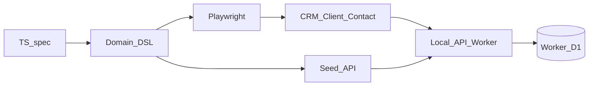
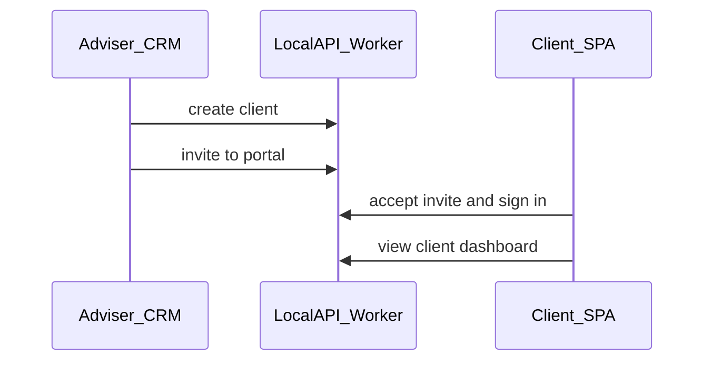

# ADR 0003: Executable E2E specs (TypeScript DSL)

| | |
|---|---|
| **Status** | Proposed |
| **Date** | 2026-10-21 |
| **Deciders** | Platform / quality |
| **Related** | [ADR 0001](./0001-one-d1-database-per-account.md) (one API Worker + Worker D1 per env), [ADR 0002](./0002-tenant-auth-security.md) (cookies, principals, three SPAs) |

## Context

Typeed Forms is three tenant SPAs on one hostname (CRM, Client, Contact), backed by one API Worker and one Worker D1 per environment ([ADR 0001](./0001-one-d1-database-per-account.md), [ADR 0002](./0002-tenant-auth-security.md)). Real journeys cross those SPAs. A typical path:

1. Adviser signs into the CRM, creates a client, invites them to the client portal.
2. The client accepts the invite and uses the Client SPA.
3. Introducer / contact flows may appear on the Contact SPA with different permissions.

We already use **Vitest** (including `@cloudflare/vitest-pool-workers`) for unit and integration tests of pure functions, models, and non-trivial components. That layer stays. It does not prove that a human can complete a multi-SPA journey under real auth cookies and UI.

We need **executable specs** that:

- A human can read and confirm (“yes, that is the product behaviour”)
- Hide selectors, URLs, and cookie details
- Run against a **local** Worker + D1 (Wrangler platform emulation), not a shared remote UAT as the CI source of truth
- Reset cleanly between tests
- Cover CRM **and** Client **and** Contact — because the adviser must create the client before a client-portal invite exists

Raw Playwright in every spec couples tests to the DOM. Classic Page Object Model alone still leaks navigation and form field names into the “spec” layer. Gherkin adds a second language and step-definition glue without buying much for a small team that already lives in TypeScript.

## Decision

**Playwright + local Wrangler**, driven by a **TypeScript domain DSL**. Specs call domain verbs. Implementation details stay inside the harness.

### 1. Test pyramid (what belongs where)

| Layer | Tool | Use for |
|-------|------|---------|
| **Unit / component logic** | Vitest | Pure functions, parsers, ACL helpers, model validation, non-trivial component behaviour without a full browser |
| **Executable E2E specs** | Playwright + Wrangler + DSL | Multi-step user journeys, auth across SPAs, permission boundaries visible in the UI |

E2E stays **thin**: happy paths plus a few auth/permission edges. Push branching logic and edge cases into Vitest.

### 2. Runtime

- **Playwright** drives Chromium (and other browsers as needed) against the three SPAs.
- **Wrangler local** runs the API Worker with SPA assets and a **Worker D1** binding (same shape as a real env; see ADR 0001 local-dev note).
- **Fresh Worker D1 per test** (wipe + migrate + reseed, or an equivalent isolated DB per Playwright worker). Tests must not share mutable state.
- Local Wrangler is the **CI gate**. Shared remote UAT may exist for demos; it is not the primary automated truth.



### 3. Spec format: TypeScript DSL only

No Gherkin / Cucumber / `.feature` files. Specs are TypeScript that read like product steps.

Do **not** name the facade `Worker` — that word already means Cloudflare Workers. Use **World** (the local env under test) and **Actor** (a signed-in or about-to-sign-in persona on one SPA).

| Concept | Role |
|---------|------|
| **World** | Starts/stops local Wrangler, owns the D1 lifecycle for the test, exposes the seed cast and factories |
| **Actor** | One principal on one SPA (adviser on CRM, client on Client, introducer on Contact). Holds the Playwright context/page for that principal |
| **Tasks** | Domain verbs: `login`, `addClient`, `inviteToClientPortal`, `openClientList`, `acceptInvite` |
| **Questions / assertions** | Domain reads: `seesGreeting`, `clientListContains`, `cannotSeeClient` — implemented with Playwright expect, not raw locators in the spec |

Selectors, `data-testid`, CSS, paths, and cookie names live **only** inside the DSL. Prefer accessible queries (`getByRole`, labels) in the implementation.

### 4. Target shape (illustrative)

```ts
import { World } from "../e2e/dsl";

test("adviser creates a client and invites them to the portal", async () => {
  const world = await World.create();
  const adviser = world.actor("adviser_alice"); // CRM persona from the cast
  // Client actor exists after invite; or bind after seed creates the login
  const client = world.actor("client_dana");

  await adviser.login();
  await adviser.addClient({ firstName: "Dana", lastName: "Rees" });
  await adviser.inviteToClientPortal("Dana Rees");

  await client.acceptInvite();
  await client.viewDashboard();
  await expect(client.seesGreeting()).resolves.toContain("Dana");

  await world.destroy();
});
```

Cross-SPA journey the suite must support:



Contact SPA follows the same Actor pattern with introducer personas from the cast.

### 5. Seed cast and factories

- Ship a small **default cast**: named personas with fixed roles and permissions (e.g. full adviser, restricted adviser, introducer contact). Enough to exercise ACL without inventing users in every file.
- Tests **opt into** extra data via factories (`world.seed.client(...)`, `world.seed.case(...)`) rather than loading every fixture on every run.
- Prefer **Given** via seed / internal test APIs (fast, stable). Prefer **When / Then** via the UI so the journey under test stays honest.
- Do not log in through the UI for every precondition unless the login ceremony itself is what the spec is checking ([ADR 0002](./0002-tenant-auth-security.md)).

### 6. Isolation and hygiene

| Rule | Detail |
|------|--------|
| **D1 per test** | Reset or isolate Worker D1 before each test. Parallel Playwright workers need separate DBs or serial DB access. |
| **No implementation in specs** | No CSS, XPath, `data-testid`, or raw `page.goto` in `*.spec.ts` files. |
| **Domain failures** | Task wrappers should fail with the domain step name (“inviteToClientPortal”), not only a generic timeout. |
| **Auth realism** | Use real cookie sessions from ADR 0002. Do not stub `tf_session` in a way that skips the login ceremony unless a documented test-only helper exists for *Given*. |
| **Suite size** | Prefer fewer E2E specs. Duplicate coverage belongs in Vitest. |

### 7. Scope

**In scope (v1 of this decision)**

- CRM, Client, and Contact SPAs on the local tenant Worker
- Journeys that start in CRM (create / invite) and continue in Client or Contact

**Out of scope (follow-up)**

- Admin Worker / platform console E2E
- Visual regression / screenshot baselines as the primary gate
- Load / performance testing

## Consequences — benefits

| Benefit | Why it matters |
|---------|----------------|
| **Human-readable specs** | Product and engineering can confirm behaviour without reading selectors |
| **Stable under UI churn** | Selector changes update the DSL once, not every spec |
| **Cross-SPA truth** | Adviser → invite → client portal is one executable story |
| **Local isolation** | Matches “one Worker D1 per env”; resets cannot touch shared UAT data |
| **Clear pyramid** | Vitest stays for logic; E2E stays for journeys |

## Consequences — costs

| Cost | Mitigation |
|------|------------|
| **DSL is product code** | Treat it as a maintained package under `e2e/` (or similar). Review DSL changes like API changes |
| **Slower CI** | Keep the suite thin; run E2E on PR + main, not on every unit-only change if needed later |
| **Wrangler + Playwright orchestration** | One documented bootstrap (`World.create`) owns start, migrate, seed, and teardown |
| **Parallelism vs D1** | Default to one DB per Playwright worker, or run DB-mutating specs serially until proven safe |
| **Auth complexity** | Align helpers with ADR 0002 (principal types, SPA path cookies). Document test-only seed logins |
| **Fixture drift** | Version the cast; name personas by role (`adviser_alice`), not by ephemeral UI labels |

## Alternatives considered

| Alternative | Why not (for v1) |
|-------------|------------------|
| Raw Playwright in every spec | Specs become DOM scripts; humans cannot confirm product intent easily |
| Page Object Model only (no domain verbs) | Still leaks pages and fields into the narrative; weaker than Actor + Tasks |
| Cucumber / Gherkin `.feature` files | Second language + step glue; little gain when authors are TypeScript-fluent |
| Shared remote UAT as CI truth | Flaky shared state; conflicts with per-env D1 isolation |
| E2E for all logic | Slow and brittle; Vitest already covers pure / component logic |
| God object named `Worker` | Collides with Cloudflare Workers; hard to grow for multi-actor flows |
| Load every fixture every test | Slow and obscure intent; use a small cast + opt-in factories |

## Example journeys (minimum set)

These are the kinds of specs the harness should make easy; names are illustrative.

1. **Adviser creates client and invites to portal** — CRM create → invite → Client SPA accept → dashboard visible.
2. **Restricted adviser cannot open another adviser’s client** — cast persona with limited ACL; assert domain denial in the UI.
3. **Introducer sees only permitted contact flows** — Contact SPA actor from the cast.

## Follow-up work

- [ ] `e2e/` (or `packages/e2e-dsl`) with `World`, `Actor`, tasks, and questions
- [ ] Playwright config that boots Wrangler local and tears it down
- [ ] Migrate + wipe + reseed Worker D1 per test (or per worker)
- [ ] Default cast SQL/JSON seed aligned with ADR 0002 `logins` / principals
- [ ] First specs: create client + invite; one ACL denial; one Contact smoke
- [ ] CI job: Vitest unit then Playwright E2E
- [ ] Later: Admin Worker console E2E (separate ADR or amend this one)

## References

- [ADR 0001 — one D1 per worker environment](./0001-one-d1-database-per-account.md)
- [ADR 0002 — tenant auth security](./0002-tenant-auth-security.md)
- [Playwright](https://playwright.dev/)
- [Cloudflare Wrangler](https://developers.cloudflare.com/workers/wrangler/)
- [Screenplay pattern (inspiration for Actor / Tasks / Questions)](https://www.infoq.com/articles/Beyond-Page-Objects-Test-Automation-Serenity-Screenplay/)
