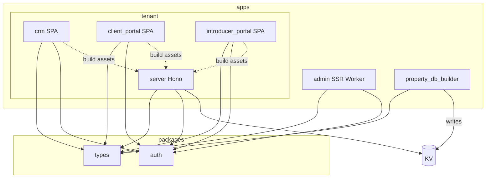

# ADR 0004: Ideal monorepo layout

| | |
|---|---|
| **Status** | Proposed |
| **Date** | 2026-10-23 |
| **Deciders** | Platform / engineering |
| **Related** | [ADR 0001](./0001-one-d1-database-per-account.md) (Admin Worker vs one API Worker per env), [ADR 0002](./0002-tenant-auth-security.md) (shared auth package, three SPAs), [ADR 0003](./0003-e2e-executable-specs.md) (E2E across SPAs), [ADR 0005](./0005-deployment-pipeline.md) (CI build → R2 → operator deploy) |

## Context

Typeed Forms today lives in a **single** React Router / Cloudflare Worker app. Models sit under `app/models/`. That works for exploration. It does not match the deployables we already decided:

- **Admin Worker** — registry, tenant setup, migrations; must stay off the tenant request path and out of the tenant bundle ([ADR 0001](./0001-one-d1-database-per-account.md))
- **API Worker per environment** — Hono APIs plus three SPAs on one hostname ([ADR 0001](./0001-one-d1-database-per-account.md), [ADR 0002](./0002-tenant-auth-security.md))
- **Shared models** — Admin D1 and Worker D1 schemas must stay in sync across apps without copy-paste
- **Shared auth** — same cookie/session helpers for Admin and tenant ([ADR 0002](./0002-tenant-auth-security.md))
- **Workers bundle limits** — migration SQL and provisioning must not ship in the tenant script
- **Property enrichment** — public property datasets are combined offline and served from KV; that work is not a firm-facing Worker

We need a **pnpm monorepo** that makes those boundaries obvious in the filesystem and in the build graph.

## Decision

Use **pnpm workspaces**. Apps are deployables or jobs. Packages are shared libraries with no Cloudflare entrypoint of their own.

```
apps/
  admin/                    # Admin Worker — SSR
  tenant/
    server/                 # API Worker entry — Hono + OpenAPI/Swagger docs
    crm/                    # Adviser CRM SPA
    client_portal/          # Client portal SPA
    introducer_portal/      # Introducer portal SPA
  property_db_builder/      # Batch/cron: public property data → KV
packages/
  types/                    # All domain models
  auth/                     # Session / cookie / CSP helpers (ADR 0002)
```



### Naming vs earlier ADRs

| Repo path | Earlier ADR wording |
|-----------|---------------------|
| `apps/tenant/crm` | CRM SPA |
| `apps/tenant/client_portal` | Client SPA |
| `apps/tenant/introducer_portal` | Contact SPA |

Prefer **`introducer_portal`** in paths and new docs. “Contact” in ADRs 0001–0003 means the same SPA.

### Apps

| App | Role | Runtime |
|-----|------|---------|
| **`apps/admin`** | Customer registry, tenant setup, schema migrations, operator UI | Cloudflare Worker, **SSR** |
| **`apps/tenant/server`** | Tenant HTTP APIs (Hono), OpenAPI/Swagger-generated docs, static asset host for the three SPAs | Cloudflare Worker (one script per `workers` row) |
| **`apps/tenant/crm`** | Adviser / staff UI | SPA → built into tenant Worker assets |
| **`apps/tenant/client_portal`** | Client portal UI | SPA → built into tenant Worker assets |
| **`apps/tenant/introducer_portal`** | Introducer portal UI | SPA → built into tenant Worker assets |
| **`apps/property_db_builder`** | Combine public property datasets; write the result to **KV** for tenant reads | Batch / cron job — **not** on the firm request path; not a fourth user-facing firm Worker |

### Packages

| Package | Contains | Must not contain |
|---------|----------|------------------|
| **`packages/types`** | All domain models (Admin + Worker D1), Zod/TS schemas, table helpers that are pure types/SQL metadata | React, Hono routes, Worker bindings, migration runners |
| **`packages/auth`** | Session seal/unseal, cookie names, CSRF helpers, CSP helpers shared by Admin and tenant ([ADR 0002](./0002-tenant-auth-security.md)) | Product UI, D1 table DDL |

Models move out of `app/models/*` into `packages/types` when we cut over. Apps **import** models; they do not redefine them.

No `packages/ui` in this ADR. Shared UI can be added later if duplication forces it.

### Dependency rules

- Every app that needs models depends on `@typeed/types` (or the workspace name we choose).
- Admin and tenant (server + SPAs) depend on `@typeed/auth` where they handle sessions.
- **`apps/tenant/*` must not depend on `apps/admin`.**
- **`packages/*` must not depend on `apps/*`.**
- `property_db_builder` may use `types` for shared shapes of property payloads; it does not import tenant UI or Admin SSR.

### Migrations

DDL and the migration runner live under **`apps/admin`** (or a path only Admin owns and bundles). The Admin Worker applies migrations to each Worker D1 ([ADR 0001](./0001-one-d1-database-per-account.md)). The tenant Worker **does not** ship migration SQL and **does not** run DDL.

### Tenant build and deploy

One Cloudflare Worker artifact per environment:

1. Build `crm`, `client_portal`, and `introducer_portal` (Vite / React Router SPA builds as chosen per app).
2. Emit or copy their static output into the tenant Worker **assets** directory used by `apps/tenant/server`.
3. Build / bundle `server` (Hono) with those assets attached.
4. Deploy that script as `worker-{id}-{slug}` with `WORKER_DB` (and KV bindings as needed).

```text
pnpm -C apps/tenant/crm build
pnpm -C apps/tenant/client_portal build
pnpm -C apps/tenant/introducer_portal build
# → assets land under tenant server asset root
pnpm -C apps/tenant/server build && wrangler deploy
```

SPA routes and `/api/*` share the tenant hostname. Auth cookies stay same-origin ([ADR 0002](./0002-tenant-auth-security.md)).

### Admin build and deploy

Separate script (`typeed-admin`). SSR app + Admin D1 binding + Cloudflare API token for provisioning. No tenant SPA assets in this bundle.

### `property_db_builder`

- Runs on a schedule or as an explicit job.
- Reads public property sources, normalises, writes into **KV**.
- Tenant `server` reads that KV at request time for enrichment.
- Failure of the builder must not block Admin or tenant deploys; stale KV is an ops concern, not a deploy coupling.

### Tooling

- **pnpm workspaces** at the repo root (`pnpm-workspace.yaml`).
- TypeScript via package `exports` and/or project references.
- Root scripts orchestrate `typecheck`, `test`, and the tenant asset → Worker pipeline.
- Turborepo (or similar) is **not** required for this decision. Add it later only if cache/fan-out becomes painful.

## Consequences — benefits

| Benefit | Why it matters |
|---------|----------------|
| **Bundle isolation** | Admin migrations and provisioning stay out of the tenant script; Workers size limits stay manageable. |
| **One model source** | `packages/types` stops Admin / CRM / portals / APIs from drifting. |
| **One auth source** | `packages/auth` matches ADR 0002’s “one auth package, separate keys and directories”. |
| **Clear deployables** | Filesystem maps to Admin Worker, tenant Worker, and the property KV job. |
| **SPA → assets pipeline** | Three portals ship with the API Worker on one hostname without three Cloudflare scripts per env. |
| **E2E alignment** | ADR 0003 can target `crm` / `client_portal` / `introducer_portal` as fixed package roots. |

## Consequences — costs

| Cost | Mitigation |
|------|------------|
| **More packages and apps** | Keep the tree small: only `types` and `auth` as shared libs until proven otherwise. |
| **Tenant asset pipeline** | One root (or `apps/tenant`) script that always builds SPAs before the Worker; fail CI if assets are missing. |
| **Path renames** | Document Contact → `introducer_portal`; update ADRs and specs when cut over. |
| **Workspace discipline** | Lint or CI rules: no `apps` → `apps` imports except the documented SPA → server asset handoff (build-time, not TS imports of admin). |
| **Cutover effort** | This ADR is the target shape. Moving code out of the current single app is a separate migration, not implied by accepting the ADR. |

## Non-goals

- Step-by-step migration of the existing `my-react-router-app` tree
- Choosing SPA framework details beyond “static assets attached to the tenant Worker”
- A shared `packages/ui` design system
- Turborepo / Nx remote caching
- Putting migration SQL in `packages/types` (types may describe tables; **runners and DDL files stay Admin-owned**)
