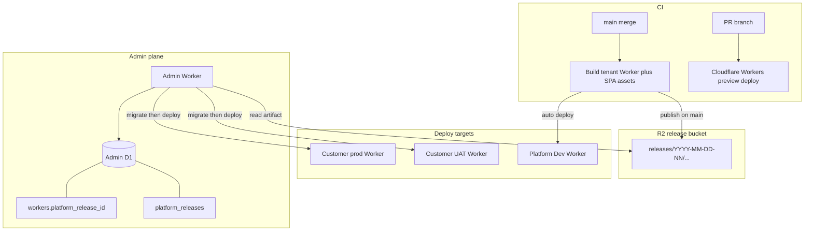

# ADR 0005: Deployment pipeline

| | |
|---|---|
| **Status** | Proposed |
| **Date** | 2026-10-28 |
| **Deciders** | Platform / engineering |
| **Related** | [ADR 0001](./0001-one-d1-database-per-account.md) (migrate then deploy, `platform_release_id`, UAT envs), [ADR 0004](./0004-monorepo-layout.md) (tenant build: SPAs → Worker assets), [ADR 0002](./0002-tenant-auth-security.md) (CSP / secrets at provision and upgrade), [ADR 0003](./0003-e2e-executable-specs.md) (smoke / E2E against local or Dev) |

## Context

Typeed Forms deploys **one API Worker + SPA assets per environment** ([ADR 0001](./0001-one-d1-database-per-account.md), [ADR 0004](./0004-monorepo-layout.md)). The Admin Worker provisions each environment and applies Worker D1 migrations. `workers.release_id` records which app bundle is running.

We do not yet have a full release pipeline for:

- Building a versioned tenant artifact once and reusing it across many Workers
- Storing that artifact somewhere the Admin Worker can redeploy from
- PR review URLs without touching customer data
- A platform Dev environment that always tracks `main`
- Operator-driven upgrades of customer UAT and production Workers
- A short change history so operators can see what lands between the tenant’s current version and a target
- Long-term release channels (early adopters before GA)

Constraints already decided elsewhere:

- Migrations are **forward-only**; the Admin Worker migrates **before** deploying the API Worker ([ADR 0001](./0001-one-d1-database-per-account.md))
- The same tenant artifact is fan-out to every environment; bindings, script name, secrets, and hostname differ
- Extra environments (UAT, training) are separate `workers` rows (`prod = false`)

Gaps today: no CI publish workflow, no platform release R2 bucket, no `platform_releases` registry, no Admin upgrade UI.

## Decision

**Versioned tenant builds go to R2. Operators upgrade Workers from the Admin Worker. There is no automated rollback.**



### Version IDs

Platform release IDs use `YYYY-MM-DD-NN`, zero-padded day sequence (e.g. `2026-10-28-01`, then `2026-10-28-02`). Lexicographic order matches time order.

Every published version **must** carry a short changelog note (from a CI changelog fragment or required publish input). Operators list changes from a tenant’s current version to a target with:

```sql
SELECT id, changelog, created_at, channel
FROM platform_releases
WHERE id > :current AND id <= :target
ORDER BY id;
```

### Who does what

| Actor | Owns |
|-------|------|
| **CI** (GitHub Actions) | Build tenant pipeline, assign version, upload R2, insert `platform_releases`, auto-deploy the platform Dev Worker, PR preview deploys |
| **Admin Worker** | Per-tenant migrate → deploy from R2 → set `platform_release_id`; operator UI for upgrades and channel promotion |
| **Tenant Worker** | Serves traffic only; never self-updates |

**Out of scope:** how the Admin platform app (`typeed-admin`) is built and deployed. That pipeline is completely separate and is not versioned, stored, or upgraded by anything in this ADR.

### Pipeline stages

#### 1. PR → preview

PRs use Cloudflare Workers Builds / Wrangler **preview** deploys for the tenant Worker and assets. Reviewers hit an ephemeral URL.

Rules:

- Preview does **not** write `platform_releases`
- Preview must **not** bind a real customer Worker D1 or customer document R2
- Use a throwaway / preview D1 and fixture data (or local Wrangler emulation for automated checks)

#### 2. Merge to `main` → build + version

On merge to `main`, CI:

1. Assigns the next `YYYY-MM-DD-NN` for that calendar day
2. Builds SPAs → copies assets into `apps/tenant/server` → bundles the Worker ([ADR 0004](./0004-monorepo-layout.md))
3. Uploads the artifact to the platform releases R2 prefix
4. Inserts Admin D1 `platform_releases` with changelog, `git_sha`, `min_schema_version`, `channel = 'dev'`, `status = 'published'`

#### 3. Auto-deploy platform Dev Worker

One Admin `workers` row is the **platform Dev Worker** (`prod = false`, owned by the platform customer). CI deploys the new artifact to that Worker after publish (migrate then deploy, same as production upgrades).

Dev is the canary: smoke / E2E against Dev gate channel promotion. Operators should not promote a release to `early_adopter` or `ga` until Dev looks healthy.

#### 4. Operator upgrade (Admin UI)

**Operators only** (for now). Customers do not self-upgrade.

Operator picks a `workers` row and a target `platform_release_id` that is `published` and allowed for that worker’s channel (see below). The Admin Worker:

1. Refuses concurrent upgrades on the same row (one in-flight upgrade per worker)
2. Applies pending Worker D1 migrations up to the release’s `min_schema_version` ([ADR 0001](./0001-one-d1-database-per-account.md))
3. Deploys script + assets from R2 via the Cloudflare Workers API (see **Deploy via Cloudflare API** below), keeping that environment’s bindings, secrets, hostname, and security headers ([ADR 0002](./0002-tenant-auth-security.md))
4. Sets `workers.platform_release_id`
5. Runs health check (schema version ≥ release `min_schema_version`)

Re-upgrading to the **same** version is a no-op. Never skip schema versions on a given D1.

#### 5. Release channels (long-term, still operator-driven)

`platform_releases.channel`:

| Channel | Meaning |
|---------|---------|
| `dev` | Just published; on platform Dev; not offered to customers yet |
| `early_adopter` | Available to a small tagged set of firms / workers |
| `ga` | Generally available to the rest of the fleet |

Promotion is a **manual** operator action on the release row (`dev` → `early_adopter` → `ga`), not time-based auto-promote. Early-adopter eligibility is a flag on the customer or worker in Admin D1. The Admin upgrade UI only lists versions whose channel the target worker is allowed to take.

#### 6. Customer UAT before production

UAT remains a second `workers` row (`prod = false`, label UAT) ([ADR 0001](./0001-one-d1-database-per-account.md)). Typical path:

1. Operator upgrades that customer’s UAT Worker to the target release
2. Firm signs off on UAT
3. Operator upgrades that customer’s `prod = true` Worker

Admin UI should **warn** if production would move to a version not yet (or never) deployed on that customer’s UAT. Do **not** hard-block forever when the customer has no UAT row.

### R2 artifacts

Dedicated **platform releases** bucket — **not** tenant document R2.

Object keys follow a fixed convention from the release id. Do **not** store an artifact path column; always derive it:

```text
releases/{id}/
  worker.mjs          # module-syntax Worker bundle (main module)
  assets/...          # SPA static assets (content-hashed filenames)
  manifest.json       # git_sha, min_schema_version, build metadata
```

Example: release `2026-10-28-01` → `releases/2026-10-28-01/worker.mjs`, `releases/2026-10-28-01/assets/…`, `releases/2026-10-28-01/manifest.json`.

The versioned artifact must **not** embed customer secrets or per-env bindings. Those are applied at deploy time from the `workers` row and Admin-managed secrets.

SPA assets use content-hashed names so a Worker deploy swaps the asset manifest and clients do not stick on stale JS after upgrade.

### Deploy via Cloudflare API

The Admin Worker updates each tenant script with the Cloudflare **HTTP API** (same account token already used for provisioning). Wrangler is for CI/local; runtime upgrades do not shell out to Wrangler.

Script name is `workers.app_worker_name` (e.g. `worker-42-example-financial`). High-level steps for one upgrade after R2 fetch:

1. **Read artifacts** from R2 at `releases/{id}/` (Worker module + asset files + `manifest.json`).
2. **Upload static assets** (Workers Assets direct upload):
   - Register the asset manifest
   - `POST /accounts/{account_id}/workers/assets/upload?base64=true` with multipart file parts
   - Receive a completion **JWT** authorizing those assets on the next script upload  
     ([Direct Uploads](https://developers.cloudflare.com/workers/static-assets/direct-upload/))
3. **Upload the Worker module** with bindings preserved for this environment:

   `PUT /accounts/{account_id}/workers/scripts/{script_name}`  
     `Content-Type: multipart/form-data`
   - Part `metadata` (JSON): at least `main_module`, plus `bindings` (D1 `WORKER_DB`, KV, R2 docs prefix, plain-text env such as `CLIENT_AUTH`), `compatibility_date` / flags, and `assets.jwt` from step 2  
   - Part named as `main_module` (e.g. `worker.mjs`) with the module bytes from R2  
     ([Upload Worker Module](https://developers.cloudflare.com/api/resources/workers/subresources/scripts/methods/update/), [multipart metadata](https://developers.cloudflare.com/workers/configuration/multipart-upload-metadata/))
4. **Do not** wipe secrets on every upgrade. Prefer reusing existing Worker secrets (`inherit` / secrets API separately) so signing keys and the like survive. Hostname / route attachment is provisioning-time; upgrades replace script + assets only unless the operator is changing host config.

Secrets and per-env binding values come from Admin D1 / the secrets store, never from the R2 artifact. CI may call the same upload APIs (or Wrangler) for the platform Dev Worker; the Admin Worker uses the API path for customer fleets.

### Admin D1: `platform_releases`

Relational table (same style as `customers` / `workers`):

| Column | Purpose |
|--------|---------|
| `id` | `YYYY-MM-DD-NN` (primary key); R2 path is always `releases/{id}/` |
| `created_at` | Publish time |
| `git_sha` | Source commit |
| `channel` | `dev` \| `early_adopter` \| `ga` |
| `min_schema_version` | Worker D1 `schema_migrations` floor this bundle requires |
| `changelog` | Required short note |
| `status` | `published` \| `yanked` |

`workers.platform_release_id` is the running release id (FK-like reference to `platform_releases.id`).

`yanked` releases are not offered for **new** upgrades. Yank carefully: the fleet may still be running that id.

**Support window (policy):** keep current GA and the previous GA installable until the fleet has largely caught up. Do not delete R2 objects for versions still referenced by any `workers.platform_release_id`.

Optional later: `worker_upgrade_events` (operator, from→to, started/finished, result) for audit. Not required to accept this ADR.

### Rollback

**No automated rollback.**

Worker D1 migrations stay forward-only. If an upgrade is bad, ship a new `YYYY-MM-DD-NN` and fix forward.

Redeploying an older bundle does **not** undo DDL. An older bundle is only safe if its `min_schema_version` is still satisfied by the D1 — usually false after a migration that raised the floor. Any emergency redeploy of a prior schema-compatible artifact is an **out-of-band** ops procedure, not a product feature in the Admin UI.

### Defaults

| Topic | Choice |
|-------|--------|
| CI | GitHub Actions for build / publish / Dev deploy |
| PR previews | Cloudflare Workers Builds / Wrangler preview |
| Dev target | One shared platform Dev Worker row, not per-developer remotes |
| Channel promotion | Manual operator action |
| Changelog source | CI changelog fragment or required publish input |

## Consequences — benefits

| Benefit | Why it matters |
|---------|----------------|
| **One artifact, many Workers** | Same tested bundle for Dev, UAT, early adopters, and GA |
| **R2 as source of truth for bundles** | Admin can redeploy without rebuilding from git at upgrade time |
| **Operator control** | Fleet pace stays with the platform while firms still get UAT-before-prod |
| **Changelog between versions** | Operators (and later firms) can see what they are taking |
| **Channels** | Early adopters absorb risk before GA without a separate codebase |
| **Preview isolation** | PR review without customer data exposure |

## Consequences — costs and mitigations

| Cost / risk | Mitigation |
|-------------|------------|
| **Partial fleet** (many `platform_release_id`s) | Support window; Dev canary; channel gates; yank only with care |
| **Migrate-then-deploy failure mid-upgrade** | Leave worker in `migration_failed` / failed upgrade state; fix forward; one upgrade at a time per row |
| **No automated rollback** | Strong Dev smoke; UAT-before-prod; small early-adopter set; fix-forward releases |
| **Preview mis-binding** | CI templates never attach customer D1/R2 to preview Workers |
| **Stale SPA caches** | Content-hashed assets + new Worker asset manifest on every deploy |
| **Secret leakage into artifacts** | Bindings and secrets only at deploy time |
| **Missing implementation** | Follow-up checklist below; this ADR is the contract |

## Alternatives considered

| Alternative | Why not |
|-------------|---------|
| Rebuild from git on every tenant upgrade | Slow, non-reproducible, harder to prove “same bits” across the fleet |
| Store artifacts only in CI cache / GitHub Releases | Admin Worker needs a Cloudflare-native fetch path; R2 fits the account |
| Customer self-serve upgrades now | Deferred; operators-only keeps blast radius small while the pipeline matures |
| Automated rollback UI | Conflicts with forward-only migrations; false sense of safety after DDL |
| Auto time-based channel promotion | Operators need Dev / early-adopter evidence before GA |
| Per-developer remote Workers as the main canary | One platform Dev Worker is enough; local Wrangler covers individual work |
| Pages-only preview without the Worker | Tenant product is the Worker + assets on one hostname; preview that shape |

## Non-goals

- **Admin platform app deployment** — build, version, and ship of `typeed-admin` is a completely separate concern; not covered here
- Customer self-serve upgrades (future note: hybrid is compatible later — operators publish channels; customers pick timing within available versions)
- Automated rollback or schema downgrade
- Storing a per-release artifact path in Admin D1 (use `releases/{id}/` by convention)
- Deleting historical R2 releases that any worker still runs
- Per-developer always-on remote preview Workers as a substitute for platform Dev

## Follow-up work

- [ ] GitHub Actions: tenant build on `main`, version bump `YYYY-MM-DD-NN`, changelog required
- [ ] Platform releases R2 bucket/prefix and CI upload of `worker` + `assets` + `manifest.json`
- [ ] Admin D1 DDL + model for `platform_releases`; wire FK-like use of `workers.platform_release_id`
- [ ] Update [`worker.ts`](../../my-react-router-app/app/models/admin/worker.ts) comment example from `2026.06.1` to `YYYY-MM-DD-NN`
- [ ] Align ADR 0001 example strings (`2026.10.1`) with this format when next revised
- [ ] CI auto-deploy platform Dev Worker after publish (migrate → deploy → set `platform_release_id`)
- [ ] Cloudflare Workers preview pipeline for PRs with non-customer D1/bindings
- [ ] Admin UI: list releases, show changelog delta, upgrade a worker, promote channel, yank
- [ ] Early-adopter flag on customer or worker; filter upgrade targets by channel
- [ ] UAT-before-prod warning when upgrading `prod = true`
- [ ] In-flight upgrade lock / status per `workers` row
- [ ] Optional: `worker_upgrade_events` audit table
- [ ] API Worker health check vs release `min_schema_version` (also listed in ADR 0001)

## References

- [ADR 0001 — one D1 per worker environment](./0001-one-d1-database-per-account.md)
- [ADR 0004 — monorepo layout](./0004-monorepo-layout.md)
- [`worker.ts`](../../my-react-router-app/app/models/admin/worker.ts) — `platform_release_id`
- [Cloudflare Workers Builds](https://developers.cloudflare.com/workers/ci-cd/builds/)
- [Upload Worker Module](https://developers.cloudflare.com/api/resources/workers/subresources/scripts/methods/update/)
- [Multipart upload metadata](https://developers.cloudflare.com/workers/configuration/multipart-upload-metadata/)
- [Workers static assets — direct upload](https://developers.cloudflare.com/workers/static-assets/direct-upload/)
- [Cloudflare R2](https://developers.cloudflare.com/r2/)
- [Wrangler](https://developers.cloudflare.com/workers/wrangler/)
